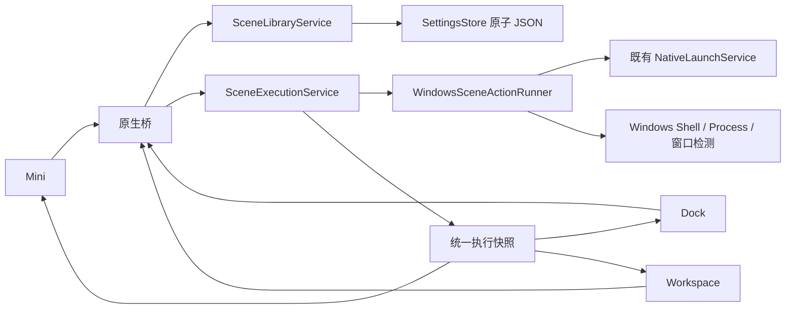

# Desktop Hub — M2.1 场景化组合启动实施报告

日期：2026-10-10（Asia/Shanghai）。版本：0.2.1。正式依据：根目录 PRD v0.7.1。

M2.1 已实现场景管理、五类动作、独立场景调度、显式依赖、真实结果和三个界面集成。继续使用 .NET 8、WPF、WebView2、既有 HTML/CSS/JavaScript 与原子 JSON 配置。应用启动台、Windows 窗口宿主及已验收原型没有重写；没有推进 M2.2 文件资源管理。

## 1. 开始检查与保护

开发前读取 PRD 全文、M1 与 M1.5 实施报告、现有代码和测试，确认 AppEntry、LauncherPin、SettingsStore、NativeLaunchService 与 Windows 快捷方式解析均可复用。没有发现 AGENTS.md。开发前与交付前执行 `git status --short`，均返回 `fatal: not a git repository`；此目录没有 Git 元数据，因此无法列出原有未提交修改或生成提交记录。

所有既有 src、desktop、tests、scripts、prototype 文件在修改前复制到 `artifacts/m21-baseline/`，附 SHA-256 清单。本轮变更清单和前后哈希见 [change-manifest.json](m21-evidence/change-manifest.json)。旧报告及旧原生验收证据保留；M1.5 回归使用新的 `docs/m21-evidence/m15-regression/` 目录。用户实际应用配置没有用于测试。

## 2. 实际文件清单

| 文件 | 本轮内容 |
| --- | --- |
| `src/DesktopHub.Core/Scenes.cs`（新增） | Scene / SceneAction / ActionDependency / SceneExecution / ActionExecution；配置校验、无环检查、场景库服务 |
| `src/DesktopHub.Core/SceneExecutionService.cs`（新增） | DAG 调度、执行快照、同场景串行、失败传播、取消、本地诊断 |
| `src/DesktopHub.Core/WindowsSceneActionRunner.cs`（新增） | 五类 Windows 动作、路径匹配、启动凭据、进程/窗口等待、受限脚本参数及超时保护 |
| `src/DesktopHub.Core/AppSettings.cs` | schemaVersion=3 与场景集合 |
| `src/DesktopHub.Core/SettingsStore.cs` | 场景深复制、增量迁移、损坏场景隔离和原文件备份 |
| `src/DesktopHub.Core/SettingsValidator.cs` | 保留应用库校验，新增场景规范化和引用失效计算 |
| `src/DesktopHub.Core/AppLibraryService.cs` | 删除应用保留场景并标记失效；校验新的场景固定引用 |
| `src/DesktopHub.Core/NativeLaunchService.cs` | 向场景服务提供既有入口启动、解析与本地路径校验；独立启动策略不变 |
| `src/DesktopHub.Windows/HubApplication.cs` | 共用场景服务和执行状态广播 |
| `src/DesktopHub.Windows/NativeBridge.cs` | 场景 CRUD、选择器、运行协议；被引用应用删除确认 |
| `src/DesktopHub.Windows/Program.cs` | 明确启用的隔离 M2.1 原生验收入口 |
| `src/DesktopHub.Windows/SceneSmokeTests.cs`（新增） | 真实 Windows 场景、脚本、等待、三个界面及第二宿主验收 |
| `src/DesktopHub.Windows/SmokeTests.cs` | M1.5 固定入口回归改用真实场景记录 |
| `src/DesktopHub.Windows/DesktopHub.Windows.csproj` | 版本 0.2.1 |
| `desktop/scenes.js`（新增） | 原生场景中心、可视化编辑器、共享执行结果 |
| `desktop/desktop.js` | 读取原生场景、混合固定、删除影响提示、保留独立应用 UI |
| `desktop/desktop.css` | 复用 Quiet Desktop token 的编辑器、状态及紧凑布局 |
| `desktop/native.js` | 场景消息与执行事件白名单 |
| `desktop/index.html` | 加载原生场景适配文件 |
| `desktop/tests/native-scenes.test.mjs`（新增） | 场景 UI 与三界面协议测试 |
| `desktop/tests/desktop-adapter.test.mjs` | 场景真实化后的预期更新 |
| `tests/DesktopHub.Scene.Tests/Program.cs`（新增） | 调度、依赖、存储、引用、取消等 17 项行为测试 |
| `tests/DesktopHub.Scene.Tests/DesktopHub.Scene.Tests.csproj`（新增） | 无额外测试框架依赖的测试工程 |
| `tests/DesktopHub.Core.Tests/Program.cs` | schema=3 预期及真实场景固定数据；既有断言保留 |
| `scripts/build.ps1` | 将场景与前端测试纳入常规构建 |
| `scripts/test-m21-native.ps1`（新增） | 隔离原生验收、实际宿主重启与按运行归档 |
| `scripts/test-m15-native.ps1` | 可选证据目录，保护旧验收记录 |
| `README.md` | 当前运行与场景操作说明 |
| `docs/M2.1_Bridge_Protocol.md`（新增） | 场景通信契约和状态语义 |
| `docs/M2.1_Implementation_Report.md`（新增） | 本报告 |

另生成 `docs/m21-evidence/` 的测试日志、运行记录、截图、哈希与时间证据，以及更新 `artifacts/win-x64/` 发布产物。`prototype/` 源文件与开发前哈希一致，见 [保留检查](m21-evidence/prototype-preservation.json)。

## 3. 架构与应用关联



AppEntry 仍是独立的应用主记录。SceneAction 优先保存 `appEntryId`，不复制程序路径、启动参数或工作目录；每个动作开始启动时读取最新应用配置。同一应用可被任意多个场景引用，动作名称可以作为场景内的显示名称。高级直接程序路径只构造临时启动入口，不另建应用表。

删除被引用应用前，UI 列出受影响场景，桥接接口再次要求 `confirmReferences=true`。确认后场景和动作保留，动作标记 `referenceInvalid`，重新从应用库选择即可修复。启动时也会重新检查引用，失效不会静默启动其他应用。

配置仍保存于 `%LOCALAPPDATA%\DesktopHub\settings.json`。schema 1/2 升至 3，保留应用、布局、窗口与旧目标数据；没有自动把 M0 演示路径转成真实动作。旧的演示场景固定引用若无真实记录，会显示失效入口，可在固定入口管理中重新选择。

有效 JSON 中的损坏场景或无效依赖单独隔离，其他有效场景和应用库仍加载，并保留原配置副本。完全损坏 JSON 继续使用原有恢复与备份机制。保存拒绝无效依赖和循环，不替换之前有效文件。

## 4. 调度、等待和并发

SceneAction 的 `displayOrder` 只决定显示顺序。ActionDependency 指定动作、前置动作、completed/process/window 条件与等待超时。Kahn 算法检查无环；每个 Action ID 只建立一个任务及一个完成信号，菱形依赖不会重复调度。

无依赖动作可以并行，每个实例最多 8 个同时进行的 Windows 动作。依赖先等待前置结果，再等待指定进程或窗口，最后执行动作自己的固定延迟。前置 Failed 或因依赖/停用而未执行，后续标为 Skipped；其他独立任务继续。依赖观察超时会让正在等待的动作 Failed，其后续依赖跳过。已运行而跳过的应用带成功前置结果，仍能满足进程/窗口条件。

每次点击创建新的 SceneExecution ID 和独立场景配置快照。同一场景通过信号量串行调度，最多 16 个未完成实例可排队；达到队列保护上限时明确提示，不丢弃已接受的实例。不同场景可同时运行，共用按目标路径的应用启动锁，防止竞争启动。最近的启动凭据同时核对 PID 与创建时间，覆盖新进程路径信息暂不可读的窗口；不把 PID 重用当成原进程。

应用默认跳过已运行实例。检测枚举同名候选后核对实际 EXE 绝对路径，并支持多个匹配实例；不会仅因名称相同而跳过。无权读取路径时继续诚实报告诊断，不能保证所有提权进程、别名路径或启动器都能可靠去重。用户可选择每次启动，或为启动器指定最终等待 EXE 路径。

动作完成条件明确区分 submitted、process_appeared、window_appeared。默认进程/窗口等待 10 秒，可修改到最长 10 分钟；进程出现不表示应用加载完成，窗口出现也不表示业务初始化完成。

延迟、等待与执行使用异步任务；不会阻塞 WPF UI 线程。退出宿主取消调度等待；不会因此杀掉用户启动的真实应用。删除/编辑场景不会改动已创建实例的快照。

## 5. 五类动作与脚本边界

| 动作 | 实现与结果语义 |
| --- | --- |
| 应用 | 复用 EXE/LNK 解析和原生启动；默认跳过已运行；支持直接路径高级模式 |
| 网页 | 只接受合法 HTTP/HTTPS；交给系统默认浏览器；每次可再次打开 |
| 文件 | 校验本地路径、存在性与普通文件类型，使用 Windows 默认关联打开；失效返回真实错误 |
| 文件夹 | 校验目录，调用 Windows 文件资源管理器 |
| 脚本 | 用户选择或明确填写已有 BAT/CMD/PS1；参数按独立元素保存；终端可见，等待退出码且有超时 |

PowerShell 使用 `-NoProfile -File` 和 ArgumentList，不设置 ExecutionPolicy Bypass。BAT/CMD 使用固定 cmd 参数结构，路径与参数拒绝命令控制/变量展开字符，包括 `& | < > ^ % ! ? " ( )`；因此含这些字符的批处理路径或参数不支持，可用 PowerShell 脚本。脚本编码由 Windows 的相应执行环境处理。

默认普通用户权限；脚本可单独选择 `runas`，由 Windows UAC 处理。没有提权绕过。脚本每个执行实例最多触发一次，新实例完成后可再次执行；另可配置“本次 Desktop Hub 会话一次”。脚本默认以退出码 0 判断成功；非零码和超时分别报告真实原因。

脚本超时不自动终止进程，终端保持可见。如果已记录的前次脚本进程仍运行，同一动作的新请求返回 `previous_script_running`，提示检查终端，避免超时后自动重叠。系统 UAC/启动对话框也有请求等待上限；超时后的系统对话框需用户处理，系统可能在用户之后确认时继续启动，不能宣称已撤销操作。

## 6. UI 完成情况

UI 使用 ui-ux 技能检查，沿用现有 Quiet Desktop 配色、字体、按钮和窗口行为。

- Workspace 首页保留完整独立应用启动台，快捷场景仍是并列入口。
- 场景中心支持新建、重命名、自定义图标/符号、启停、排序、删除、执行和 Mini/Dock 固定。
- 编辑器左侧可排序动作列表，右侧当前动作配置；从现有应用库选择、添加其他动作、编辑参数、停用、删除、配置多个依赖。
- “按列表顺序执行”显式生成相邻依赖；“全部独立执行”清除依赖；上下移动只改变显示顺序。左侧显示每个动作的独立/依赖关系和延迟。
- 高级参数按需展开，包含重复规则、工作目录、参数、目标进程路径、窗口标题及脚本 UAC。
- Mini 支持最多四个应用/场景混合入口，运行计数和结果入口可打开 Dock 查看详细原因。
- Dock 保留常用应用网格，并展示快捷场景与可展开执行结果。
- 三界面消费宿主同一快照；UI 没有各自的模拟场景调度器。执行完成不会自动收起 Dock 或 Workspace。

视觉检查覆盖实际深/浅编辑器、场景中心、执行失败、受影响删除确认、Dock 和 Mini。最终卡片依赖摘要及对齐见 [最终场景中心](m21-evidence/final-visual/restart-scenes.png)。长路径与错误可换行，窄 Workspace 将两列改为上下布局。

## 7. 实际编译与测试

最终 Release 编译和依赖运行时发布均成功，**0 警告、0 错误**。发布 EXE/Windows DLL/Core DLL 与编译输出 SHA-256 一致，UI 副本也核对源文件。环境继续使用本机 .NET SDK 8.0.425、WebView2 SDK 1.0.4258.31 与 Windows 11 x64；没有升级框架。

| 结果类型 | 结果 | 证据 |
| --- | --- | --- |
| 自动化：既有 Core | 27 通过，0 失败 | [构建与自动化](m21-evidence/build-tests.txt) |
| 自动化：场景调度/存储 | 17 通过，0 失败；使用受控 runner，不能当成真实 Windows 启动 | [构建与自动化](m21-evidence/build-tests.txt) |
| 自动化：前端及原型状态回归 | 39 通过，0 失败；含 6 项新的场景 UI 检查 | [构建与自动化](m21-evidence/build-tests.txt) |
| 实际运行：M2.1 Windows | 40 通过，0 失败；首进程 35 项、第二宿主 5 项 | [运行记录](m21-evidence/native/run-20261010T035636409Z/run.json)、[完整结果](m21-evidence/native/run-20261010T035636409Z/results.json) |
| 实际运行：M1/M1.5 Windows 回归 | 73 通过，0 失败，包含真正宿主重启 | [回归结果](m21-evidence/m15-regression/run-20261010T035739085Z/results.json) |
| 实际运行：既有 Core 受控程序启动 | 总计 30 通过（27 项 Core + 3 项真实进程），0 失败 | [真实启动回归](m21-evidence/regression-core-native.txt) |
| 发布 | 成功，编译/发布哈希一致 | [发布日志](m21-evidence/publish.txt)、[哈希](m21-evidence/published-build-hashes.json) |

真实验收从编辑器选择五个现有 AppEntry，不重新输入路径，实际启动 `winver/charmap/mstsc/msinfo32/colorcpl`，检查 PID/EXE 路径与可见窗口；Dock 与 Mini 再次运行全部正确跳过。五动作的开始时间均早于任意一个动作完成，实际并行时序见 [时间证据](m21-evidence/parallel-native-timings.json)。顺序依赖、250ms 延迟和进程等待使用受控 GUI 程序验证。

实际十秒窗口超时验证 Failed、依赖 Skipped、独立动作继续，并用前端定时计数验证 UI 响应。还验证同名不同路径、多实例、AppEntry 参数/目录更新、CMD 重复运行、命令字符拒绝、退出码 7、脚本有限超时与超时防重入，网页/文件/文件夹实际 Windows Shell 请求，以及删除引用确认和重启配置。

系统关联测试的“成功”只代表 Windows 接受打开请求，没有把网页加载或关联程序初始化当成已验收。受控脚本只写自己的测试标记文件，未修改用户文件。原生验收使用独立 `m21-smoke-data` / `m15-smoke-data`，关闭本次创建的 GUI 程序；系统浏览器、文本编辑器或文件夹的测试页签可能保留，可正常关闭。

早期失败运行保留在带时间的证据目录。开发沙盒曾导致透明 WebView2 的 0x8000FFFF，最终实际验收使用沙盒外普通用户进程，没有提升权限。测试修复包括等待受控程序 Loaded 标记、使用 ASCII 批处理和独立受控程序目录、等待第二实例可观测；这些失败没有计为通过。最后一轮回归还发现颜色管理属性页需要实际关闭按钮，场景测试现复用既有 M1.5 的关闭处理；单实例程序转发导致新 PID 立即退出的失败运行也保留在归档中，最终两套原生验收均再次通过。

## 8. 人工待验证与已知限制

已实现的 M2.1 核心功能没有以模拟替代。以下尚未作为全面兼容验收通过：Windows 10、其他 DPI/多屏与长时间性能；PowerShell 不同执行策略/签名与参数的实机矩阵；真实 UAC 允许/取消、需长时间人工输入的脚本；第三方启动器、提权应用、Store/MSIX 与特殊快捷方式。

进程路径不可读、符号链接/短路径别名及启动器派生目标可能无法完全去重，diagnostic 记录不确定性。窗口检测限定可见顶层窗口和可选标题片段，不等于应用内部就绪。脚本判断依赖退出码，不分析脚本业务输出或隔离脚本自身的行为。

执行实例在内存保留最近约 30 个已完成结果及所有未完成结果；重启不重新执行旧实例。本地 `scene-executions.jsonl` 保留完成快照，超过约 2 MiB 轮换为 `.previous`，不提供复杂历史平台。场景/应用没有低数量上限，仍有配置 16 MiB、请求 1 MiB、等待/延迟最长 10 分钟和执行队列安全界限。

自定义图标本轮提供内置图标和自定义短符号，不支持导入任意图片。动作排序使用明确上下移动，不增加拖放导入能力；现有 M1.5 原生文件选择器继续保留。M1 未实现的全局快捷键、托盘、自启等保持原边界。文件扫描、标签索引、监测、系统代理、桌面图标隐藏及远程/云服务均未开发。

## 9. 手动创建与复现

1. 用原有 `打开 Desktop Hub.lnk` 或 `artifacts/win-x64/DesktopHub.Windows.exe` 打开应用，保留相邻 UI、DLL 和 runtimes。
2. 在首页“我的应用”添加至少五个常用 EXE/LNK，逐个点击确认独立启动。
3. 进入场景中心 → 新建场景，命名并选择图标 → 添加动作 → 启动应用，从应用库选择；重复添加五次。
4. 保持无依赖即可并行。点击“按列表顺序执行”生成真实依赖；选中一个动作可改等待进程/窗口，设置开始前延迟和默认 10000ms 超时。排序箭头不改变这些依赖。
5. 按需要添加 HTTP/HTTPS 地址、本地文档、目录或无副作用的已有脚本；脚本参数每行一个，工作目录与重复规则在高级参数中设置。
6. 保存场景 → 执行场景 → 展开逐动作结果。重复执行检查已运行应用跳过；脚本在新实例中可再执行。
7. 固定到 Mini/Dock，再从对应入口执行，确认状态一致且面板保持展开。退出并重新打开后检查配置仍在。
8. 修改被引用应用的参数/目标后运行场景；移除应用时检查受影响场景列表，确认后进入场景编辑器重新关联失效动作。

```powershell
.\scripts\build.ps1 -Offline
.\scripts\test-m21-native.ps1 -SkipBuild
.\scripts\test-m15-native.ps1 -SkipBuild -CoreFixtureIntegration -EvidenceDirectory 'E:\桌软工作台\docs\m21-evidence\m15-regression'
.\scripts\publish.ps1 -SkipTests -Offline
```

最终发布目录已更新，原快捷方式路径继续可用。**Git 提交未生成：当前目录不是 Git 仓库。** 交付包含源码、修改前快照、变更哈希清单、实际编译产物和完整验收证据。
