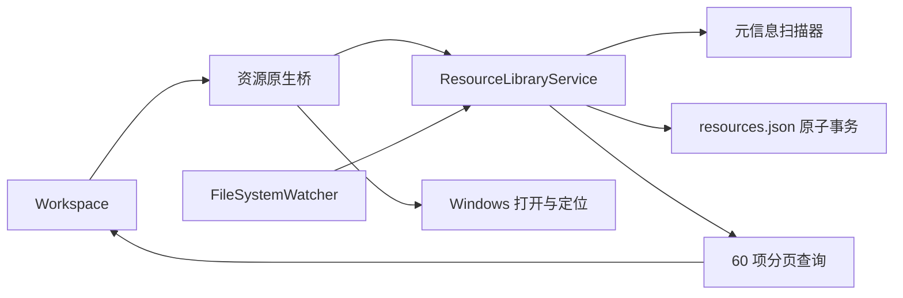

# Desktop Hub — M2.2 实施报告

日期：2026-10-10（Asia/Shanghai）。版本：0.2.2。需求依据仅为根目录 `PRD.md` v0.7.1 和 `docs/Desktop_Hub_M2.2_Codex_%E5%BC%80%E5%8F%91%E6%8F%90%E7%A4%BA%E8%AF%8D.md`。

M2.2 已完成真实文件虚拟索引、授权来源监测、标签及离线建议、搜索收藏、资源库三视图、临时文件夹浏览、失效引用修复和索引清理。继续使用 .NET 8、WPF、WebView2 与现有 Quiet Desktop HTML/CSS/JavaScript。Mini、Dock、Workspace 宿主、独立多应用库和场景引擎保留。开发停止在 M2.2，等待用户实际验收。

## 1. 开发前检查、现有边界与保护

阅读两份需求全文、M1/M1.5/M2.1 实施报告、桥接协议、宿主、前端适配、存储和测试。代码确认 M1.5 已有 AppEntry/LauncherPin、多应用 CRUD、EXE/LNK 独立启动及原子 settings.json；M2.1 已有五类动作、AppEntry 引用、显式依赖、延迟、进程/窗口等待、失败传播和共享执行结果。

修改前基线构建为 0 警告、0 错误；Core 27、场景 17、前端 39 项均通过。M1 历史未实现的原生全局快捷键、托盘、自启等没有被假设为已完成，本轮不扩展这些范围。既有窗口内快捷交互、Esc、主题、透明宿主及边缘悬停按旧原生验收回归。

项目开始与交付检查均不是 Git 仓库，`git status --short --branch` 返回 `fatal: not a git repository`，无法生成阶段提交或判断原有未提交状态；没有擅自初始化 Git。替代回退点为 `artifacts/m22-baseline-20261010T061523978Z/`，包含修改前 src/desktop/tests/scripts/prototype、README/PRD 的副本及 SHA-256 清单。交付差异及原型保留检查见 [change-manifest.json](m22-evidence/change-manifest.json) 和 [prototype-preservation.json](m22-evidence/prototype-preservation.json)。

用户真实配置没有用于测试，真实桌面仅调用系统路径发现，没有确认导入或做文件变化实验。文件新建、改名、删除、目录暂时改名及属性测试均限于本轮创建的 `m22-owned-*` 测试夹具。应用生产代码只写自身资源元数据，不移动、删除、重命名、复制、覆盖用户资源，不创建标记文件或修改文件属性。原 PRD、原型源文件、原快捷方式及旧实施报告保留。

## 2. 模块与文件清单

| 文件 | 变更 |
| --- | --- |
| `src/DesktopHub.Core/Resources.cs`（新增） | SourceRoot、Resource、ResourceSource、Tag、ResourceTag、TagSuggestion 与独立 ResourceStore |
| `src/DesktopHub.Core/ResourceScanner.cs`（新增） | 已知桌面目录、元信息扫描、进度/取消、链接与云占位边界、文件身份查询、占用重试 |
| `src/DesktopHub.Core/ResourceLibraryService.cs`（新增） | 预览授权、核对、事件合并、监测恢复、分页检索、标签/建议、收藏、浏览、修复与清理 |
| `src/DesktopHub.Windows/ResourceBridge.cs`（新增） | Workspace 资源协议、原生目录/修复选择器、受限 Windows 打开请求 |
| `src/DesktopHub.Windows/ResourceSmokeTests.cs`（新增） | 实际 Windows 选择器、真实 WebView2 UI、文件事件、原生重启及大目录响应验收 |
| `src/DesktopHub.Windows/NativeBridge.cs` | 将资源白名单请求交给 ResourceBridge |
| `src/DesktopHub.Windows/HubApplication.cs` | 后台载入资源配置、启动核对、变更/进度事件及退出释放 |
| `src/DesktopHub.Windows/Program.cs` | 独立 `--index-smoke` / `--index-smoke-restart` 测试入口、数据目录和 mutex |
| `src/DesktopHub.Windows/DesktopHub.Windows.csproj` | 版本 0.2.2，沿用现有 UI 文件发布规则 |
| `desktop/resources.js` / `desktop/resources.css`（新增） | 真实资源页、来源授权、三视图、标签、搜索、收藏、浏览、修复与清理交互 |
| `desktop/index.html` / `desktop/native.js` | 加载资源模块、请求与事件白名单 |
| `desktop/desktop.js` | 资源页真实状态、移除资源演示徽标和旧导入占位提示 |
| `tests/DesktopHub.Resource.Tests/`（新增） | 24 项真实临时文件系统/存储行为测试 |
| `desktop/tests/native-resources.test.mjs`（新增） | 7 项资源前端契约与交互测试 |
| `scripts/build.ps1` | 常规构建纳入资源和前端测试 |
| `scripts/test-m22-native.ps1`（新增） | 两次独立 Windows 宿主验收、按时间保留证据 |
| `README.md` | M2.2 当前运行、来源确认和资源操作说明 |
| `docs/M2.2_Bridge_Protocol.md`（新增） | 参数、状态、安全边界及 Windows 接口参考 |
| `docs/M2.2_Implementation_Report.md`（新增） | 本报告 |

另生成 `docs/m22-evidence/` 测试日志、截图、运行记录与哈希，并更新 `artifacts/win-x64/` 开发发布目录。没有创建正式安装包。

## 3. 架构、数据关系与一致性



资源配置保存于 `%LOCALAPPDATA%\DesktopHub\resources.json`，schemaVersion=1。应用、场景、固定入口和窗口配置仍使用原有 settings.json schemaVersion=3；不迁移、不把资源塞入旧设置，也不从 M0 示例路径创建真实索引。资源载入、扫描、检索和写入在后台执行。

SourceRoot 保存来源类型、规范路径、独立递归策略、授权时间、可用/监测状态、最近核对时间及错误。Resource 使用独立 GUID，保存当前/最后已知路径、类型/扩展名、创建/修改时间、文件身份线索、状态、收藏及看到时间。ResourceSource 是多对多关系；同一路径在重复、嵌套来源中只保留一条资源，移除来源仅清理不再被其他来源引用的索引。

Tag/ResourceTag 为正式多标签关系；TagSuggestion 单独记录名称、依据、类型和 Pending/Accepted/Rejected 状态。未接受的建议不会出现在正式标签关系中；拒绝状态在刷新和重启后保留。

资源变更串行化，复制事务数据、校验引用与唯一性后写临时文件、Flush(true)，最后原子替换。失败不替换原文件和内存状态。损坏 JSON、空条目、非法路径或版本保留原文件并停止资源写入，资源页显示原因，原应用与场景配置不受影响。当前资源 JSON 安全容量为 128 MiB；这不是文件内容缓存。

## 4. 桌面发现与确认流程

1. 系统已知文件夹机制返回真实 DesktopDirectory，使用 DoNotVerify 避免硬编码或为路径发现创建目录。资源页显示实际路径、未导入/已授权状态及可能的 OneDrive 标识。
2. 当前用户桌面需主动查看预览；公共桌面首次必须勾选允许读取，原生接口也检查授权标志；自定义目录必须通过原生目录选择器选择。
3. 扫描只读元信息，默认只枚举直接子项，文件夹本身是一项资源。预览显示文件/文件夹数量、递归策略、可读取情况及警告，可取消。
4. 预览只在内存保存，有效期 15 分钟；取消后 token 无效。未确认前没有正式来源、资源写入或后台监测。
5. 用户确认后原子保存来源和资源，再核对预览期间的变化并开启监测。单目录开启/关闭递归也经过预览确认；关闭递归时说明将移除仅此来源引用的深层索引元数据。

递归最多 64 层，单次扫描最多 100000 项，超过上限明确提示或保留未读取范围的不确定状态。目录联接、符号链接、循环和未知重解析点不继续遍历。已识别的 Cloud Files 重解析点与链接区分；本地可用目录可读取，云占位目录不展开、占位文件不主动下载。同步标识是提示，不能当作已验证所有同步服务。

## 5. 监测、状态、修复与清理

FileSystemWatcher 只为已授权来源注册。约 400ms 合并短事件；持续事件约 2 秒触发核对；同一时刻只运行一轮后台核对，运行期间新请求会触发后续核对。重命名提示队列有界，启动、监测错误、用户刷新都可完整重新核对。60 秒低频健康检查只用于来源不可用/监测失败恢复，不做全盘高频扫描。

| 状态 | 行为 |
| --- | --- |
| Active | 元信息可访问；打开前仍重新核对存在性、身份、链接和占位属性 |
| Missing | 原引用找不到，保留 ID、标签、收藏和来源关系 |
| PendingRepair | 用户进入重新关联流程；取消选择器后仍可继续修复 |
| SourceUnavailable | 来源或局部目录无法读取，保留记录，不把该范围全部判成永久删除 |

同目录重命名通过文件身份线索或系统重命名事件可靠匹配后保留 ID、标签、收藏；被可靠识别的目录改名，其子项再以身份核对后更新。跨目录移动不自动追踪，原项保留 Missing，用户手动重新关联。

修复使用原生文件/目录选择器，校验真实目标及原资源类型，更新原 ID。若目标已有索引，将其收藏、标签与来源关系合并至原 ID。修复至来源外，只登记明确选择的单项，使用精确文件过滤监测，不扫描该目录的其他内容。

失效页支持搜索、状态筛选、勾选和第二次确认清理。只允许 Missing/PendingRepair，SourceUnavailable 应先检查磁盘/权限。清理只删除 Desktop Hub 索引和关系，不删除实际文件。移除来源也显示孤立索引的影响并要求确认。

## 6. Workspace 与用户操作

沿用已有 Quiet Desktop token、字体、按钮、主题及窗口行为。首页的独立应用启动台与快捷场景保留，Mini/Dock 不装载完整文件库。

- 资源库：列表、类型图标网格、标签视图共享同一原生分页数据，每页 60 项；图片/PDF/文档只显示类型图标。
- 检索：文件名或正式标签名称搜索，多选标签取交集；收藏和收藏页筛选；失效页按状态筛选。
- 打开：双击非控件区域或“打开”按钮；详情可打开所在文件夹、在资源管理器中显示。成功仅代表 Windows 接受请求，缺失等错误如实显示。
- 文件夹：“浏览”只返回临时子项，不保存；可单独加入所选项，或为当前文件夹预览并确认递归来源。
- 标签：主题、时期、自定义新建/重命名/删除，详情中绑定或移除多个标签。卡片内可接受、拒绝或编辑建议，依据在提示和详情中说明；时期优先来自创建时间，不读取文件正文。
- 来源：个人桌面路径、公共桌面勾选、自定义选择、递归、监测状态和移除。设置的“文件来源”指向真实资源库。

资源库不直接执行程序、脚本和快捷方式等执行性资源，提示通过应用库、场景或资源管理器处理。链接与云占位资源的打开会返回可解释的限制提示。原生接口拒绝前端自由路径、目录穿越、额外参数和无效会话。

## 7. 实际编译与测试

最终 Release 编译：**0 警告、0 错误**。本机为 Windows 11 x64，.NET SDK 8.0.425、WebView2 SDK 1.0.4258.31，沿用工作区离线依赖，没有更换框架。普通用户进程运行 Windows 验收，没有要求管理员权限。

| 验证层 | 结果 | 证据 |
| --- | --- | --- |
| 基线 Core/场景/前端 | 27 / 17 / 39 通过 | 修改前实际构建输出，源码快照 |
| 交付 Core | 27 通过，0 失败 | [完整构建](m22-evidence/build-tests-release.txt) |
| 场景调度/存储 | 17 通过，0 失败，受控 runner | 同上 |
| M2.2 文件系统/存储 | 24 通过，0 失败；真实临时目录与 FileSystemWatcher | 同上 |
| 前端契约/原型状态 | 46 通过，0 失败，包含资源新增 7 项 | 同上；前端受控应答不能代替 Windows 验收 |
| M2.2 实际 Windows | **33 通过，0 失败**；首宿主 30 项、第二宿主 3 项 | [最终运行](m22-evidence/native/run-20261010T065257855Z/run.json)、[逐项结果](m22-evidence/native/run-20261010T065257855Z/results.json) |
| M1/M1.5 实际 Windows | **73 通过，0 失败**，含真正宿主重启 | [旧阶段回归](m22-evidence/m15-regression/run-20261010T065116469Z/results.json) |
| Core 真实受控进程回归 | 30 通过（原 27 + 实际启动 3），0 失败 | [回归日志](m22-evidence/m15-regression.txt) |
| M2.1 实际 Windows | **40 通过，0 失败**，含第二宿主 | [回归运行](../docs/m21-evidence/native/run-20261010T064558008Z/run.json)、[回归日志](m22-evidence/m21-regression.txt) |
| 发布 | win-x64 依赖运行时发布；编译/发布核心二进制与 UI 哈希核对 | [发布日志](m22-evidence/publish.txt)、[产物哈希](m22-evidence/published-build-hashes.json) |

首次普通沙盒测试阻止测试目录联接创建，普通用户进程重跑后通过。原生测试早期修正了目录选择器 UIA 定位与异步保存等待；默认编辑器锁定测试笔记曾阻止测试自身的改名，之后把系统打开样本与改名样本分开。真实修复选择器、文件名/标签搜索、收藏、多标签交集和重新启动最终均通过。失败运行按时间保留，未计为通过。

### 18 项需求验收映射

| 项 | 结论与证据范围 |
| --- | --- |
| 1 实际桌面路径、不默认导入 | **实际通过**：Windows 发现接口，来源/监测为零；未导入真实桌面 |
| 2 默认直接子项、独立递归 | **自动化通过 + 实际通过**：默认 2 文件/1 文件夹不含深层；独立递归、浏览 token 预览有文件系统测试 |
| 3 公共/自定义授权与监测 | **自动化通过 + 实际通过（边界/自定义）**：公共未勾选被原生拒绝、自定义实际目录选择器和确认启动监测；真实公共桌面确认导入留待用户验收 |
| 4 多目录、重叠去重 | **自动化通过**：独立、重复、嵌套来源关系与移除其中一个 |
| 5 新建/重命名保留关系 | **自动化通过 + 实际通过**：真实事件、离线改名、目录子项改名，ID/标签/收藏保留 |
| 6 删除保留 Missing | **自动化通过 + 实际通过**：仅删除本轮测试文件后保留索引与关联 |
| 7 来源不可用区别于删除 | **自动化通过**：临时改名测试来源、恢复后核对；真实断开移动磁盘/ACL 矩阵需人工验证 |
| 8 重新关联保留标签收藏 | **自动化通过 + 实际通过**：真实修复文件选择器、旧 ID、目标已有索引合并、外部单项授权 |
| 9 清理不改原文件 | **自动化通过 + 实际通过**：第二次确认、其他文件存在/哈希不变 |
| 10 临时浏览不长期索引 | **自动化通过 + 实际通过**：未加入前元数据字节不变，显式加入一项后才新增 |
| 11 三类标签、多标签交集 | **自动化通过 + 实际通过**：三类 CRUD/绑定及实际双标签筛选 |
| 12 建议接受/拒绝 | **自动化通过 + 实际通过**：接受前无关系，编辑接受、拒绝重启持久化，卡片接受实测 |
| 13 三视图、搜索收藏打开 | **实际通过**：真实列表/网格/标签页、文件名/标签搜索、收藏页与 Windows 打开/定位；全部使用真实索引 |
| 14 事件突发和重新核对 | **自动化通过**：350 项实际事件突发、删除后刷新和去重；未声称强制复现了 OS 缓冲溢出 |
| 15 重启恢复 | **自动化通过 + 实际通过**：独立第二 Windows 宿主保留 ID、来源、标签、收藏、关系 |
| 16 大目录、进度、取消、响应 | **自动化通过 + 实际通过**：1800 项扫描进度/取消、分页及 WebView2 定时响应 |
| 17 离线核心能力 | **自动化通过（本地功能）**：离线依赖构建、所有索引/标签路径无网络实现与依赖；没有断开用户网卡，物理断网环境留待人工验收 |
| 18 M1.5/M2.1/窗口/主题/快捷交互 | **实际通过**：73 与 40 项旧原生验收；历史未实现的原生全局快捷键不宣称已验收 |

## 8. 性能观察与兼容边界

1800 项临时目录的核心预览+确认+核对约 **549ms**，异步响应计数 25；真实 WebView2 预览约 **238ms**，5ms 定时器推进 **47 次**。最终记录见 [large-preview-performance.json](m22-evidence/native/run-20261010T065257855Z/large-preview-performance.json)。该运行完成截图与业务操作后宿主工作集为 416722944 字节（约 397 MiB），不包含全部 WebView2 子进程，也不是长期常驻内存基线。

分页只传当前 60 项，不读文件内容或媒体缩略图；查询在原生锁内只复制返回页。JSON 全库事务仍会复制/序列化资源元数据，极大资源库并未做全面性能验收；当前上限与错误提示见协议。无法撤销已提交的 Windows 关联打开请求，也不保证关联程序完全加载。

需用户/后续兼容验证：真实 OneDrive 占位与目录重定向矩阵、不同同步客户端、FAT/exFAT/移动盘、不同 ACL 权限、长时间监测、Windows 10、其他 DPI/多显示器和百万级资源。文件身份不可读或不可靠时使用系统可验证的事件，无法确认则保留失效项等待人工修复，不承诺跨目录自动追踪。

桌面图标隐藏/恢复、开机自启完善、原生全局快捷键补齐和正式安装包均未开发，没有进入 M2.3。

## 9. 可操作的实际验收

1. 用原有 `打开 Desktop Hub.lnk` 或 `artifacts/win-x64/DesktopHub.Windows.exe` 打开。保留相邻 UI、DLL、runtimes。
2. 先从“我的应用”独立启动已保存程序，并执行已有场景，确认 Mini/Dock/Workspace 行为仍正常。
3. 进入“文件资源库”，查看当前用户桌面的实际路径。先取消一次扫描，确认没有来源或索引新增。再次预览并确认导入，检查默认只有直接子项。
4. 若需要公共桌面，主动勾选允许预览，再确认导入。自定义目录通过 Windows 目录选择器选择；建议先用自己新建的无害验收目录。
5. 在验收目录新建文本文件，观察自动出现；添加标签、收藏，自己改名后检查 ID 对应的标签/收藏仍保留。不要用重要文件做删除实验。
6. 在资源卡片接受/拒绝/编辑建议，切换列表/图标/标签，搜索文件名或标签，勾选两个正式标签检查交集；进入收藏页。
7. 非递归文件夹点击“浏览”，确认子项没有自动进入长期库；选择一项“加入资源库”，或“为此文件夹开启递归”预览后确认。
8. 对自己创建的测试文件删除或移动后，进入“失效资源”；点击重新关联选择现有目标，检查标签、收藏仍在。勾选另一个无用 Missing 项并确认清理，确认实际文件没有被删除。
9. 在来源管理开启/关闭递归，检查监测状态；移除一个与其他来源重叠的来源，检查其他来源引用的资源还在。
10. 退出并重新打开，检查资源、来源、标签、收藏、应用与场景；在实际断网环境再测试本地资源功能。

复现命令：

```powershell
.\scripts\build.ps1 -Offline
.\scripts\test-m22-native.ps1 -SkipBuild
.\scripts\test-m21-native.ps1 -SkipBuild
.\scripts\test-m15-native.ps1 -SkipBuild -CoreFixtureIntegration -EvidenceDirectory 'E:\桌软工作台\docs\m22-evidence\m15-regression'
.\scripts\publish.ps1 -SkipTests -Offline
```

原生验收会短暂使用 Windows 选择器和测试窗口，创建自己的目录及无害文件；系统文本编辑器/资源管理器中的测试页签可能保留，可正常关闭。所有早期与最终验收证据均保留。**本轮完成后等待用户实际验收，不自动进入下一阶段。**
